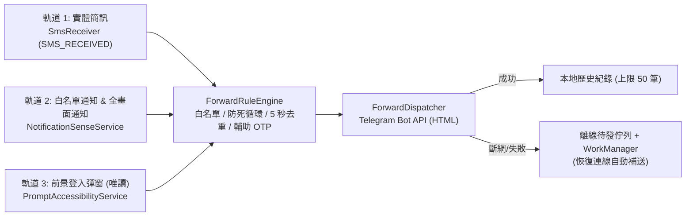

# SmsSense 系統架構筆記

## 1. 三軌單向擷取管線

## 2. 關鍵設計原則

1. **原文優先**：簡訊合併完整多段 PDU 後原文轉發；僅在命中驗證碼語境時於頂端多加一行 `<code>` 方便單擊複製，杜絕截錯造成困擾。
2. **嚴格白名單與防死循環**：App 通知與登入彈窗偵測一律採白名單制，且引擎層硬編碼排除所有 Telegram 客戶端與 `SmsSense` 自身，避免轉發形成無窮迴圈。
3. **純唯讀無障礙感知**：`PromptAccessibilityService` 僅宣告監聽 `typeWindowStateChanged`，不申請手勢執行權限，守住零遠端點擊的資安底線。
4. **事件驅動省電**：三條擷取軌皆由 Android 系統事件喚醒；僅在發送失敗時交由 `WorkManager` 等待網路恢復後補發，平時零定時輪詢。
